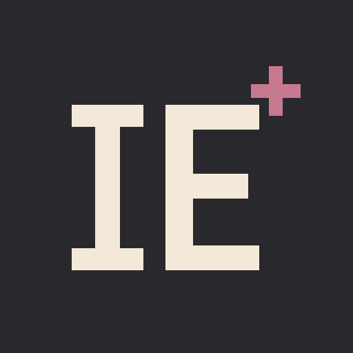
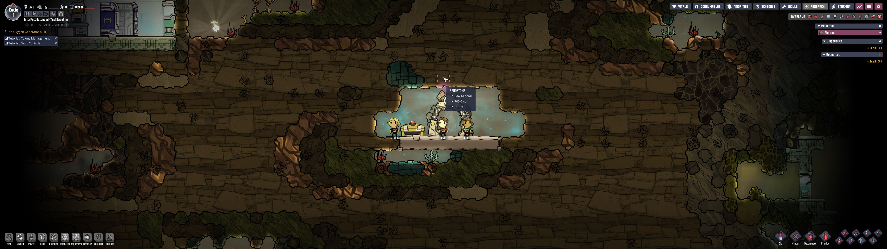
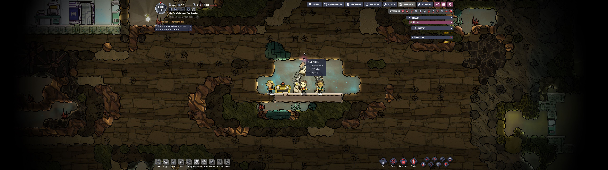
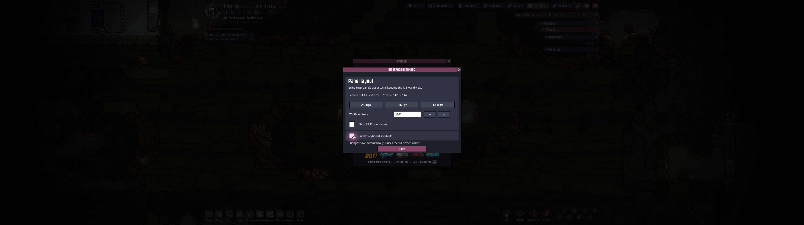

# Interface Extended

<!-- workshop:overview:start -->
Bring Oxygen Not Included's HUD closer to the center of a wide monitor while keeping the world view at full width.

Choose a 2560 px or 3360 px HUD, enter a custom width, or restore the full screen width. Panels keep the game's UI scale. Settings use ONI's own buttons, fonts and window styling.
<!-- workshop:overview:end -->

<!-- workshop:compatibility:start -->
## Compatibility

- Version 1.4.0. Checked on Windows, ONI U59-744825-SCRPAN, Spaced Out!, 5120 × 1440, UI scale 110%.
- No external mod dependency. Harmony and UI components come from ONI.
- Metadata allows the base game and DLC. Base-game-only play, other operating systems, other resolutions and public testing branches remain untested.
- Other mods that reposition the same HUD containers may conflict. See the [compatibility notes](docs/compatibility.md).
- Optional keyboard shortcuts remain unverified. Every setting is available by mouse.
<!-- workshop:compatibility:end -->

Install from [Steam Workshop](https://steamcommunity.com/sharedfiles/filedetails/?id=3820540318), then enable the mod in ONI. To prepare a local copy instead, see the [build instructions](docs/development.md#build).

<!-- workshop:screenshots:start -->
## Screenshots

Full-width HUD:

Centered 2560 px HUD:

Settings window:

<!-- workshop:screenshots:end -->

These unedited 1.3.0 captures show the same paused colony and camera at 5120 × 1440 / 110% UI scale. [Capture metadata](docs/images/captures.json) records their original version and environment.

## Local installation

Copy the built mod files into their own folder inside ONI's local mods directory:

| System | Local mods directory |
| --- | --- |
| Windows | Your Documents folder, then `Klei\OxygenNotIncluded\mods\Local` |
| Linux | `~/.config/unity3d/Klei/Oxygen Not Included/mods/Local` |
| macOS | `~/Library/Application Support/unity.Klei.Oxygen Not Included/mods/Local` |

Use your actual Documents folder if it is redirected. The install script has been tested on Windows only.

<!-- workshop:usage:start -->
## Using the mod

Enable **Interface Extended** in ONI's Mods menu and restart when prompted. Open **Options > Interface Extended** from the main menu or the colony pause menu. Main-menu changes take effect when a colony loads; colony changes apply immediately.

The window provides width presets, a numeric field, 160 px steps and optional boundary guides. Width is measured in physical viewport pixels. Small values are clamped to a minimum of 1280 logical UI pixels, so a large UI scale can produce a wider HUD than requested. Set width to `0` for full width.

Settings save automatically and survive mod updates. Optional shortcuts are off by default. Enable only one copy of the mod. To remove it, disable it in Mods and restart, then remove its installation folder if desired. The mod does not add save-file data.
<!-- workshop:usage:end -->

For a manual update, close ONI and replace the DLL, metadata and shipped translations. Keep the shared settings and any legacy config files in place. [Configuration details](docs/development.md#configuration) describe their location and migration.

<!-- workshop:languages:start -->
## Languages

The UI defaults to English and follows the game's selected language when a translation is available. Russian is bundled. Other languages fall back to English. See [translation instructions](docs/translating.md) to contribute a `.po` file.
<!-- workshop:languages:end -->

<!-- workshop:support:start -->
## Support

Source code and contributions: [GitHub repository](https://github.com/glockbender/oni-interface-extended).

Report a problem in [GitHub Issues](https://github.com/glockbender/oni-interface-extended/issues), including the game/mod version, resolution, UI scale, reproduction steps and relevant `Player.log` output. Remove personal paths from logs before posting. Support is handled on GitHub.
<!-- workshop:support:end -->

[Development](docs/development.md) · [Contributing](CONTRIBUTING.md) · [Changelog](CHANGELOG.md)

MIT licensed. Oxygen Not Included and its runtime assets belong to Klei Entertainment. This is a community mod.
