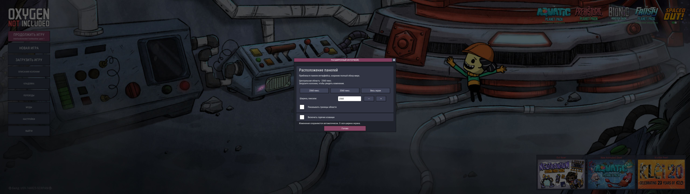

# Interface Extended

<!-- workshop:overview:start -->
Bring Oxygen Not Included's HUD closer to the center of a wide monitor while keeping the world view at full width.

Choose a 2560 px or 3360 px HUD, enter a custom width, or restore the full screen width. Panels keep the game's UI scale. Settings use ONI's own buttons, fonts and window styling.
<!-- workshop:overview:end -->

<!-- workshop:compatibility:start -->
## Status and compatibility

- **1.4.0 local build (unreleased):** public mod ID `InterfaceExtended`, settings outside the installation folder. Legacy config migration, Russian UI and the 20-step HUD scenario passed in ONI on the environment below. See [validation](VALIDATION.md) for exact binaries and coverage.
- **1.3.0 local build:** mouse controls tested in a separate colony on Windows, ONI U59-744825-SCRPAN, Spaced Out!, 5120 × 1440, UI scale 110%. English and Russian settings verified. See [validation and remaining checks](VALIDATION.md).
- No external mod dependency. Harmony and UI components come from ONI.
- Metadata allows the base game and DLC. Base-game-only play, other operating systems and other resolutions have not been tested in game.
- Other mods that reposition the same HUD containers may conflict. Public testing branches are untested.

[Compatibility review](docs/compatibility.md) explains potential interactions with DraggableUI, Fast Track, Clean HUD, Skills Info Screen, Better Info Cards and PLib Options. It is based on source inspection; it does not declare those mods incompatible or certify combinations.
<!-- workshop:compatibility:end -->

There is no Steam Workshop listing or public binary release yet. Build from source using the instructions below.

<!-- workshop:screenshots:start -->
## Screenshots

The same paused test colony and camera at 5120 × 1440 / 110% UI scale. Full width:


Centered 2560 px HUD:


Settings window:


Russian settings:



[Capture metadata](docs/images/captures.json). These are unedited captures from the 1.3.0 local build. Open an image for full resolution.
<!-- workshop:screenshots:end -->

## Install and use

Build the mod, then copy the contents of `artifacts/CenteredHud` into a folder named `CenteredHud` inside your ONI local mods directory:

| System | Local mods directory |
| --- | --- |
| Windows | Your Documents folder, then `Klei\OxygenNotIncluded\mods\Local` |
| Linux | `~/.config/unity3d/Klei/Oxygen Not Included/mods/Local` |
| macOS | `~/Library/Application Support/unity.Klei.Oxygen Not Included/mods/Local` |

On Windows, Documents can be redirected to OneDrive or another location. Use the actual Documents folder. Linux and macOS paths follow common ONI mod conventions; this project's build/install script is tested on Windows only.

<!-- workshop:usage:start -->
## Using the mod

Enable **Interface Extended** in ONI's Mods menu and restart when prompted. Use **Options > Interface Extended**, either from the main menu or the colony pause menu. With Russian selected, the path is **Настройки > Расширенный интерфейс**. Main-menu changes take effect when a colony loads; colony changes apply immediately.

The window provides width presets, a numeric field, 160 px steps, boundary guides and an optional shortcuts checkbox. Width is measured in physical viewport pixels. Small values are clamped to a minimum of 1280 logical UI pixels, so a large UI scale can produce a wider HUD than requested. Set width to `0` for full width.

Shortcuts are off by default. When enabled, **Ctrl+Shift+F8** is intended to cycle 2560 / 3360 / full width and **Ctrl+Shift+F9** to open settings. The injected-key smoke check did not trigger either action; physical-keyboard verification remains open. All settings are available by mouse.

Version 1.4.0 stores settings under ONI's `mods/config/InterfaceExtended/config.json`, outside the replaceable mod folder. Packages do not ship a default config. On the first load, an existing config at the new location takes precedence; otherwise the mod imports the installation-folder `config.json`, then the legacy `mods/Local/CenteredHud/config.json`, or uses its built-in defaults. Legacy files are left unchanged. If migration cannot write the new file, valid legacy settings remain usable and the settings window reports the save error. Malformed files are not migrated or automatically replaced; a warning is logged and defaults are used.

Enable only one copy of the mod, including when replacing the legacy `prvz.CenteredHud` installation. To remove it, disable it in Mods and restart, then remove its installation folder if desired. The mod does not add save-file data.
<!-- workshop:usage:end -->

To update a local installation, close ONI and replace the DLL, metadata and shipped translation files. Leave the shared settings and any legacy config in place.

## Build

Requires an installed copy of ONI, PowerShell 7 and a [.NET 9 runtime or newer](https://dotnet.microsoft.com/download/dotnet). A .NET SDK is not required. The first build downloads the pinned Roslyn 4.14.0 compiler from NuGet into `.tools`.

```powershell
./build.ps1 -GamePath 'D:\SteamLibrary\steamapps\common\OxygenNotIncluded'
```

Alternatively, set `ONI_GAME_PATH`. The compiler uses the installed game's framework and Unity assemblies. Those assemblies are never included in the output or this repository.

The output is `artifacts/CenteredHud`. On Windows, append `-Install` to copy it to the local mods directory. Installation refuses to run while ONI is open and does not replace user settings. A normal build does not change an installed mod.

```powershell
./tests/test-geometry.ps1
python -m pip install -r tests/requirements.txt
python scripts/localization.py
```

These checks run without ONI. [Testing](docs/testing.md) describes game checks and manual regression. A separate [development test agent and runner](tests/runtime/README.md) has completed its 20-step HUD scenario in ONI using both the local mod-difference gate and a matching strict baseline, with PNG evidence. These runs used a 29-mod collection including the agent; they do not certify every mod interaction. The harness dispatches Unity UI events and commits numeric fields through their component API; hardware keyboard input and gameplay remain outside its coverage. See [validation](VALIDATION.md) for exact runs and limitations.

For routine work, use `make check`, `make build`, `make package`, `make install` or `make translations`. `make workshop` exports the marked README sections and screenshot list for Steam; [Workshop preparation](docs/workshop.md) describes the generated files. `make test-agent` builds the separate development mod; `make test-runner` checks its external runner without the game. Set `ONI_GAME_PATH` for game-dependent tasks. Make is optional: `./tasks.ps1 -Task check` (or another task name) runs the same commands on Windows without it. The localization check requires Python 3.10+ and the dependency shown above. Builds also check the installed game's patch targets and reflected fields.

## Configuration and translations

Version 1.4.0 stores settings in ONI's `mods/config/InterfaceExtended/config.json`. If no current or legacy config exists, built-in defaults are used and the file is created on the first settings change. Close ONI before editing it manually. The migration order is described under [Using the mod](#using-the-mod).

| Key | Default | Meaning |
| --- | --- | --- |
| `Enabled` | `true` | Constrain HUD width. |
| `WidthPixels` | `2560` | Requested width; `0` uses the full viewport. Saved values are clamped to 0–32768. |
| `ShowGuides` | `false` | Show the two HUD boundaries. |
| `EnableShortcuts` | `false` | Enable the optional key combinations. |
| `CycleKey` | `F8` | Unity KeyCode name, with Ctrl+Shift modifiers. |
| `SettingsKey` | `F9` | Unity KeyCode name, with Ctrl+Shift modifiers. |

<!-- workshop:languages:start -->
## Languages

The UI defaults to English and follows the game's selected language when a translation is available. Russian is bundled. Other languages fall back to English. See [translation instructions](docs/translating.md) to contribute a `.po` file.
<!-- workshop:languages:end -->

<!-- workshop:support:start -->
## Support

Report a problem in [GitHub Issues](https://github.com/glockbender/oni-interface-extended/issues), including the game/mod version, resolution, UI scale, reproduction steps and relevant `Player.log` output. Remove personal paths from logs before posting.

Support is handled on GitHub. The planned Workshop listing will direct reports there.
<!-- workshop:support:end -->

## Development

The marked product sections above also supply the Workshop description and screenshot order. Build instructions and developer-only sections are excluded. Follow [repository instructions](AGENTS.md) when changing code, tests or documentation.

[Contributing](CONTRIBUTING.md) · [Changelog](CHANGELOG.md) · [Code and documentation review](docs/review.md)

MIT licensed. Oxygen Not Included and its runtime assets belong to Klei Entertainment. This is a community mod.
